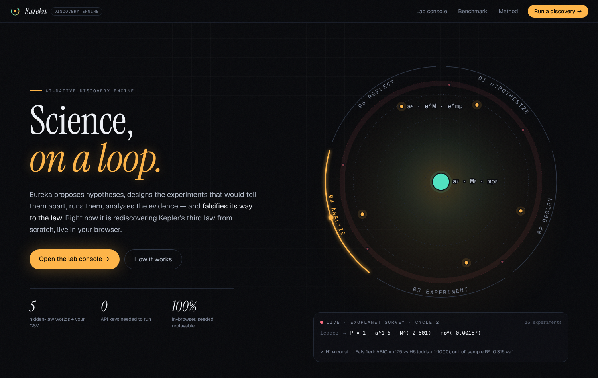
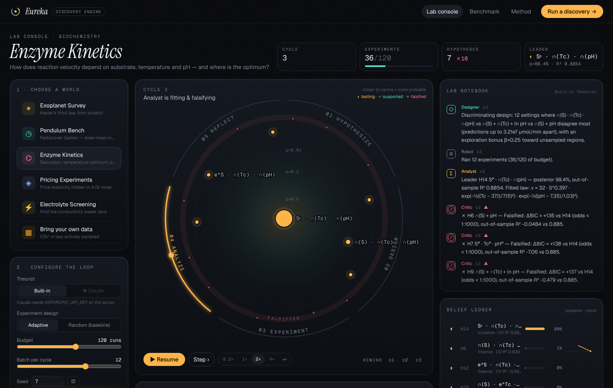
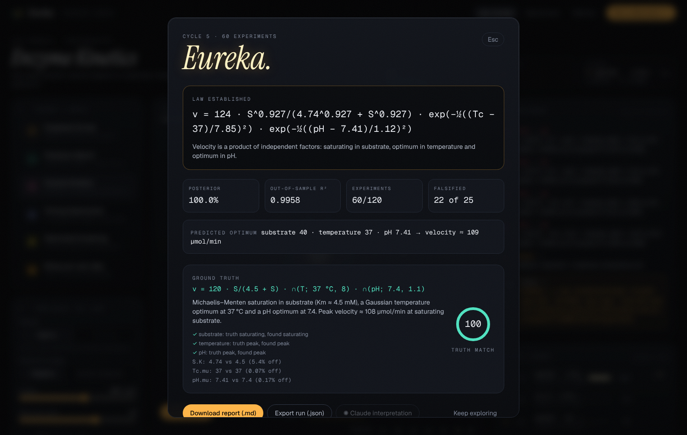

# Eureka — an AI-native discovery engine

> **Science, on a loop.** An automated loop that **proposes hypotheses, designs and runs experiments, analyses the results** — and falsifies its way to the law.



Eureka is a complete, working implementation of the *AI-native discovery engine* idea (highlighted by Y Combinator in its Requests for Startups): instead of a single model call, discovery is a **closed loop** of specialised agents with narrow, checkable jobs and a written lab notebook.

```
        ┌──────────── 01 HYPOTHESIZE ────────────┐
        │  Theorist (built-in or Claude) writes   │
        │  falsifiable laws in a symbolic grammar │
        ▼                                         │
 05 REFLECT                                 02 DESIGN
 Critic checks discovery criteria;          Designer picks settings where
 falsifies losers, applies Occam            rival laws disagree most
        ▲                                         │
        │                                         ▼
 04 ANALYZE  ◀──────────────────────────  03 EXPERIMENT
 LM fits · 5-fold CV · BIC posterior       Robot runs the (simulated) lab
 · ablation · residual audit (BH-FDR)      or reveals rows of your CSV
```

It ships with five worlds that hide real laws behind noise and red herrings — and it rediscovers them:

| World | Hidden law | What the engine has to figure out |
|---|---|---|
| ✶ Exoplanet Survey | `P = a^1.5 · M^-0.5` | Kepler's third law; planet mass is irrelevant |
| ◷ Pendulum Bench | `T = 2π√(L/g)` | √L scaling; mass doesn't matter (Galileo) |
| ⌬ Enzyme Kinetics | Michaelis–Menten × T-optimum × pH-optimum | saturation, two optima, and the best conditions |
| ◈ Pricing Experiments | `Q ∝ price^-1.6 · ads^0.3 · e^(-0.06·steps)` | price elasticity under A/B noise |
| ⚡ Electrolyte Screening | peak in concentration × Arrhenius in T | the conductivity sweet spot; the additive is a red herring |
| ▦ Your CSV | — | rows become an oracle pool: the engine chooses which to reveal |

When a run finishes you can **reveal the ground truth** and see a 0–100 truth-match score (variables, functional forms, parameter error).

## Quick start

```bash
npm install
npm run dev          # http://localhost:3000
```

No API key needed — the built-in theorist runs everything in a Web Worker in your browser.

### Optional: Claude as the Theorist

```bash
cp .env.example .env.local
# set ANTHROPIC_API_KEY=...
npm run dev
```

Switch **Theorist → ✺ Claude** in the console. Each cycle Claude receives the leaderboard, falsification verdicts, ablations, residual anomalies and a data sample, and returns new conjectures as **schema-validated structured output** in the engine's grammar (so its ideas are immediately testable). The API key stays on the server (`/api/agent`). Calls use `claude-opus-5-5` with adaptive thinking and server-side refusal fallbacks; override with `EUREKA_MODEL` / `EUREKA_EFFORT`. If Claude is unavailable mid-run, the built-in theorist takes over — the loop never stalls. Claude can also write the *interpretation* section of the final report.

### Terminal

```bash
npm run discover -- --lab enzyme --seed 3            # watch the loop in your terminal
npm run discover -- --lab kepler --report            # print the full Markdown lab report
npm run bench -- --seeds 5                           # adaptive design vs random baseline
npm test                                             # vitest suite (math, grammar, loop, Claude protocol)
```

## How it works

**1 · A grammar for falsifiable ideas.** Hypotheses are `y = b₀ + Σ gₖ(xₖ)` or `y = A · Π hₖ(xₖ)` with shapes *linear, quadratic, log, power, exp, saturating (Hill/Michaelis–Menten), peak (optimum)*. Anything expressible can be fitted, cross-validated and compared — vague ideas are rejected by the Critic before they waste an experiment.

**2 · Fitting & belief.** Levenberg–Marquardt nonlinear least squares, initialised by grid + OLS backfitting, warm-started from the previous cycle, with restarts. Posterior model probabilities via the BIC (`p(H|D) ∝ prior · e^(−BIC/2)`); predictive power via **5-fold cross-validated R²**. The Analyst switches to log-residuals when the response spans orders of magnitude.

**3 · Experiment design.** Latin-hypercube screening first; then Box–Hill style **model discrimination** — measure where the top rival laws disagree most — plus an exploration bonus and diversity repulsion. In optimisation worlds, half of each batch probes the predicted optimum once a law is trusted.

**4 · Falsification & Occam.** Losers are falsified with a written verdict (odds < 1:1000 *and* worse out-of-sample). Nested extensions whose extra terms don't pay for themselves, and observationally equivalent models with more parameters, are retired. **Ablation** removes/adds each variable; a **residual audit** tests for leftover trends and curvature with Benjamini–Hochberg FDR control — anomalies are fed back to the Theorist as repair targets.

**5 · Discovery criteria.** A law is only announced when it has ≥ 90 % posterior (incl. observationally-equivalent forms, which are reported), out-of-sample R² ≥ 0.95, a clean residual audit, every term essential (ΔBIC > 10), enough data (≥ 16 and ≥ 3× parameters) — and it holds for **two consecutive cycles** of new, adversarially chosen experiments.

## Benchmark (5 seeds per lab, `npm run bench`)

| Lab | Design | Laws found | Experiments → law | Truth match |
|---|---|---|---|---|
| Exoplanet | adaptive | 100 % | 40.0 | 100 |
| Exoplanet | random | 100 % | 35.2 | 100 |
| Pendulum | adaptive | **80 %** | 56.0 | 97 |
| Pendulum | random | 20 % | 32.0 | 88 |
| Enzyme | adaptive | 100 % | **55.2** | 99 |
| Enzyme | random | 100 % | 60.0 | 98 |
| Pricing | adaptive | 100 % | **32.0** | 92 |
| Pricing | random | 100 % | 36.8 | 93 |
| Electrolyte | adaptive | 100 % | **36.8** | 100 |
| Electrolyte | random | 100 % | 38.4 | 100 |

Adaptive design helps most where effects are subtle (the pendulum's tiny amplitude correction) and in multi-factor worlds; in the easy Kepler world random sampling is about as good. You can re-run this in the browser on the **Benchmark** page.

## The interface






- **Loop Reactor** — the five phases as an orbit with a comet on the active stage; inside, a *gravity well* where each hypothesis' distance from the centre is its posterior probability. Falsified theories are flung out to the graveyard ring; the law ignites at the centre.
- **Evidence field** — partial-residual plot: as the right law is found, the scattered cloud collapses onto its curve. Also predicted-vs-observed parity.
- **Belief ledger** — every hypothesis with status, posterior, CV R² and its belief trajectory; a graveyard with written verdicts.
- **Lab notebook** — the agents' reasoning, live (Theorist, Designer, Robot, Analyst, Critic, Claude).
- **Ablation & design space** — what matters, and where the engine chose to measure.
- **Rewind** — scrub back to any cycle; pause / step one event at a time; 0.5×–16× playback.
- **Eureka moment** — the fitted law, confidence, predicted optimum, ground-truth reveal, Markdown/JSON export.

## Project structure

```
src/engine/            the discovery engine (pure TypeScript, no UI deps)
  grammar.ts           hypothesis grammar, compile, equations
  fit.ts lm.ts         initialisation, Levenberg–Marquardt, CV, BIC
  design.ts            screening / discriminating / optimising designs
  analyze.ts           posterior, falsification, Occam, ablation, residual audit
  engine.ts            the loop (async generator of events + snapshots)
  agents/              heuristic theorist, Claude theorist, wire protocol
  labs/                simulated worlds + CSV oracle pool
  report.ts            truth scoring + Markdown report
  worker.ts runner.ts  Web Worker execution
src/server/claude.ts   server-only Claude calls (structured outputs)
src/app/               Next.js App Router: landing, /lab, /benchmark, /method, /api/agent
src/components/        Reactor, EvidenceField, ledger, notebook, modal
scripts/               CLI: discover, bench
tests/                 vitest suite
```

Built on the official Next.js starter (`create-next-app`: App Router + TypeScript + Tailwind CSS + ESLint), React 19, the Anthropic TypeScript SDK and Zod. Charts are hand-rolled SVG with a colour-blind-validated palette.

## Deploy

- **Vercel**: import the repo; optionally add `ANTHROPIC_API_KEY`.
- **Docker**: `docker build -t eureka . && docker run -p 3000:3000 -e ANTHROPIC_API_KEY=... eureka`

## Roadmap

Lab adapters (cloud labs, liquid handlers, simulators, experimentation platforms) · richer hypothesis spaces (interactions, ODEs, causal graphs, code-as-hypothesis) · cost-aware, multi-fidelity design · shared auditable notebooks.

## License

MIT
